# Product Engineering Platform

**Der gemeinsame Arbeitsraum für Produktwissen, Entscheidungen und nachweisbare Umsetzung.** Jedes digitale Produkt lebt in einem eigenen Projekt mit einem Team und einem zugeordneten Git-Repository. Jede Fachrolle trägt ihre Artefakte bei und sieht, welche Entscheidungen, Anforderungen und Nachweise daran hängen. Die Plattform führt das verbindliche Produktwissen und macht den Stand der Umsetzung aus Git, CI und Factory im Projekt sichtbar.

**Das erste Produktinkrement ist ein Obsidian-Plugin.** Das bestehende Product-Backlog-Plugin zeigt die Work Items im selben Vault. Ein Use-Case ist eine PBI-Notiz im Backlog. Die Fachrollen verwenden dieselbe Notiz für Ablauf, Randfälle, Akzeptanzkriterien und Verknüpfungen. Das Product-Engineering-Plugin ergänzt Artefaktregeln, Nachweiskette, KI-Review und Factory-Übergabe.

Eine Erkenntnis aus einem Interview kann zu einem Job, einer Anforderung, einem Use-Case-PBI und einem Test führen. Der freigegebene Feature Request bündelt genau diesen Stand für die Factory. Die finale Review kann am konkreten Commit nachvollziehen, was umgesetzt und verifiziert wurde.

## 1. Produktversprechen und Zielgruppen

| Versprechen | Funktion im Produkt | Voraussichtlicher Nutzen |
| --- | --- | --- |
| Strategische Produktreview für jedes Artefakt | Rollenbezogene KI-Review mit Kriterien, Quellen, Fundstellen, offenen Fragen und Änderungsvorschlägen | Fehlende Evidenz und Unklarheiten werden vor der Übergabe sichtbar |
| Ein Produkt-Copilot von der Idee bis zur Auslieferung | Projektbezogener Kontext über Research, PRD, Use-Cases, Backlog, Prototype, Feature Request und Review | Entscheidungen bleiben über Arbeitsphasen und Tools hinweg nachvollziehbar |
| Vom PRD zum klickbaren Prototyp | Die Plattform leitet zuerst prüfbare Use-Cases und offene Designfragen ab, dann erstellt sie eine klickbare Variante mit Code-Ansicht und Export | Das Team kann eine Idee mit Nutzern prüfen, bevor die Factory sie für die Zielapplikation umsetzt |
| Unternehmenswissen dort abrufen, wo es gebraucht wird | Suche und KI im Projekt finden autorisierte Quellen und nennen Herkunft, Version und Aktualität | Teams finden den zutreffenden Kontext und erkennen veraltete oder widersprüchliche Angaben |

**Primäre Nutzer.** Product Owner und Delivery Manager priorisieren und geben fachlich frei. Researcher und UX Designer belegen Bedarf und gestalten Abläufe. Requirements Engineers formulieren Anforderungen und Akzeptanzkriterien. Solution Architects und Engineers dokumentieren Systemgrenzen, Entscheidungen und Risiken. QA macht Prüfbarkeit und Evidenz sichtbar. Factory Engineering nutzt das freigegebene Paket für die Ausführung und Bereitstellung zur Review.

**Annahme für den ersten Einsatz.** Ein bestehendes Kundenprodukt mit einem realen Team und Repository. Projektspezifische Artefaktregeln und unterstützte Quellen werden dort erprobt. Das Produktversprechen gilt für berechtigte, angeschlossene Quellen. Geschwindigkeit und Qualität der Antworten werden im Pilot gemessen.

## 2. Projekt, Datenhoheit und Team

Ein Projekt repräsentiert **genau ein digitales Produkt oder eine eigenständig verantwortete Applikation**. Es besitzt ein Team, einen Product Owner und ein primäres Git-Repository. Im Plugin steht ein Projekt für einen registrierten Projektordner im Vault, mit einer Projektnotiz und einer zugeordneten Backlog-Base. Ein Vault kann mehrere Projektordner enthalten. Die Projekt-ID bleibt bei einer Umbenennung stabil. Wenn ein Kundenauftrag mehrere eigenständige Produkte umfasst, kann später ein gemeinsames Portfolio deren Projekte gruppieren. Diese Zuordnung präzisiert das frühere Architekturbild, in dem ein Projekt mehrere Applikationen betreuen konnte.

| Gegenstand | Führend | Wie er im Projekt erscheint |
| --- | --- | --- |
| Vision, Jobs, PRDs, Designs, ADRs und fachliche Freigaben | Produktprojekt im Obsidian-Vault | Markdown-Notizen als bearbeitbare Entwürfe, Artefaktlinks und referenzierte Freigabestände |
| Backlog und Use-Case-PBIs | Bestehendes Obsidian-Backlog im selben Vault | Rang, Parent und Status im Backlog. Ablauf und Kriterien im Inhalt derselben PBI-Notiz |
| Originale aus Interviews, Dateien oder angeschlossenen Systemen | Ursprüngliche Quelle oder freigegebene Anlage in der Plattform | Herkunft, relevante Fundstelle, Version oder Erfassungszeit, Schutzklasse und gegebenenfalls freigegebener Auszug |
| Produktionscode, ausführbare `.feature`-Dateien, Pull Requests und technische Freigaben | Git-Repository | Verknüpfte Revisions- und Commit-Referenzen mit technischen Review-Ergebnissen |
| Ausführung und CI-Nachweise | Factory und CI | Run, Versuch, Prüfbericht, geprüfter Commit und Ergebnis je Akzeptanzkriterium |
| Freigegebener Factory-Auftrag und fachliche Abnahme | Product-Engineering-Plugin und projektbezogene Freigabedaten | Fixiertes Übergabepaket und dokumentierte Entscheidung zu genau einem geprüften Stand |

Das Projekt im Vault ist der Einstiegspunkt und die verbindliche Quelle für Produktentscheidungen. Ein Artefakt hat eine stabile ID, einen Typ, einen Projektbezug, einen Owner, eine Schutzklasse und einen Lebenszyklus. Bearbeiten im Notiz-Editor und im Plugin verändert denselben Entwurf. Bei Freigabe hält das Plugin die tatsächlich übergebenen Inhalte und deren Prüfsumme zusammen mit dem Request fest. Ein späterer Edit an der Notiz verändert diesen Stand nicht. Änderungen an verknüpften Inhalten markieren betroffene Nachweise und Übergaben als prüfbedürftig. Aktive Aufträge werden bei Bedarf explizit ersetzt. Durchsuchbare Versionshistorie und Wiederherstellung als neue Entwurfsrevision gehören zum Ausbau.

Projektmitgliedschaft und Fachrolle werden getrennt gepflegt. Eine Person kann mehrere Rollen haben. Im Vault steuern Rollen Zuständigkeiten, Validierung und Aktionen im Plugin. Vertrauliche Kundendaten brauchen getrennte Vaults oder entsprechend abgegrenzte Ablagen und Zugriffsrechte. Freigabe gegenüber der Factory und Übermittlung werden an der Factory-Schnittstelle mit eigener Autorisierung geprüft. Die Projektansicht zeigt pro Artefakt, wer entscheidet und wer gerade handeln muss.

## 3. Artefaktregeln pro Produktrolle

Jedes Produkt startet mit einer **Produktvision und mindestens einem lösungsagnostischen PRD**. Produktresearch wird über Jobs to be Done (JTBD) dokumentiert. Das Team wählt ein Produktprofil, hinterlegt konkrete Pflichtartefakte und benennt Verantwortliche. Die Regel nennt jeweils den Anlass, das Pflichtartefakt, die Mindestqualität und das Gate. Zusätzliche Rollen und Artefakte können je Produkt ergänzt werden.

| Fachrolle | Beitrag | Wann verpflichtend |
| --- | --- | --- |
| Product Owner / Product Lead | Vision, Outcome-Ziele, lösungsagnostische PRDs und Priorisierung | Vision und mindestens ein PRD je Produkt. Für neue Vorhaben muss ein zuständiger PRD referenziert sein. |
| Research / Discovery | Research-Frage, Evidenz und JTBD-Karte mit Situation, angestrebtem Fortschritt, bestehenden Alternativen und Erfolgssignalen | Für jede Research-Aktivität. Unbelegte Jobs sind als Hypothesen markiert, mit geplantem Validierungsschritt. |
| Requirements Engineering | Strukturierte Anforderungen mit IDs. Use-Cases als PBIs mit Geschäftsregeln, Akzeptanzkriterien und gegebenenfalls Slices | Für Aufträge, die beobachtbares Produktverhalten hinzufügen oder ändern. Technische Enabler erhalten ein technisches Abnahmekriterium. |
| UX Design | Use-Case-Bezug, Journey oder Ablauf, Interaktionsdesign, Fehler- und Leerzustände, Validierung | Bei Interaktionsänderungen. Persona, Journey Map oder Prototyp je nach Erkenntnisbedarf und Produktprofil. |
| Solution Architecture | Technische Randbedingungen, ADRs, Schnittstellen- und Datenentscheidungen | Bei relevanten technischen Änderungen, etwa neuen Integrationen oder veränderten Vertrauensgrenzen. |
| Engineering | Umsetzungshinweise und PR-Mapping zu Request und Kriterien | Für jeden implementierten Auftrag. Tieferer Plan bei Mehrkomponentenänderungen oder Migrationsrisiken. |
| QA / Acceptance | Kriterien-Nachweis-Matrix, Gherkin-Szenarien für kritische Nutzerabläufe, CI- und weitere Prüfbelege | Nachweis pro freigegebenem Kriterium. Begründete Methodenwahl und explizite Freigabe, wenn eine andere Prüfmethode erforderlich ist. |
| Delivery / Operations / GTM | Release-Bereitschaft, Rollout- oder Rückfallplan, Support- oder Kommunikationsbedarf | Nach Risikoprofil, Kundenauflage und Auswirkung auf Betrieb oder Nutzerkommunikation. |

Das Projekt zeigt pro Rolle **fehlt**, **Entwurf**, **in Review**, **freigegeben** und **von Änderung betroffen** mit nächster Aktion. Es unterscheidet „für das Produkt erforderlich“ und „für diesen Request erforderlich“. So blockiert ein offener Designentwurf für ein anderes Vorhaben keinen versandfertigen Auftrag. Gate-Ausnahmen sind rollenbezogen, begründet und revisionsgebunden.

## 4. Nachweiskette vom Kundenproblem zur Abnahme

```mermaid
flowchart TB
    O[Produktvision] --> P[PRD mit Anforderungen]
    E[Research-Evidenz] --> J[Job to be Done]
    J --> P
    P --> U[Use-Case-PBI im Backlog]
    U --> A[Akzeptanzkriterien]
    A --> S[Gherkin-Szenarien]
    U --> F[Feature Request]
    A --> F
    S --> F
    F --> I[Pull Request und Prüf-Commit]
    I --> C[CI-Ausführung und Nachweise]
    C --> R[Fachliche Abnahme und technische Review]
    R -->|Erkenntnisse oder Änderungsbedarf| U
```



| Artefakt | Was hinein gehört | Beispiel Kundenportal |
| --- | --- | --- |
| Research / JTBD | Beobachtete Situation, Fortschritt, heutiger Workaround, Alternativen, Evidenz und Konfidenz | `JOB-12` · Vor der Wochenübergabe offene Servicefälle zuverlässig weitergeben. Evidenz kommt aus beobachteten Abläufen und Interviewstellen. |
| Lösungsagnostisches PRD | Problem, Zielgruppe, Outcome, überprüfbares Erfolgssignal, Anforderungen, Grenzen, Annahmen und offene Entscheidungen | `REQ-18` · Berechtigte Servicekoordinatoren können eine gefilterte Übersicht der für sie sichtbaren offenen Fälle für die Wochenübergabe weitergeben. |
| Use-Case-PBI | Akteur, Auslöser, Vorbedingungen, Hauptablauf, relevante Alternativen und Ergebnis. Bei mehreren Inkrementen benennt die Notiz ihre Slices. | `UC-09` · Koordinatorin exportiert die gefilterte Liste. Der Slice `S02` legt CSV fest und verweist bei Bedarf auf die Designentscheidung. |
| Akzeptanzkriterien | Beobachtbare Ergebnisse mit stabiler ID, Randfälle und Erwartungen | `AC-01` · Alle gefilterten sichtbaren Fälle werden exportiert. `AC-02` · Fälle anderer Organisationen bleiben ausgeschlossen. |
| Verifikation | Erwartete Szenarien, geprüfter Commit, Lauf, Ergebnis und Evidenz für das jeweilige Kriterium | `SC-091` und `SC-092` · Filter und Organisationsgrenze. Der CI-Report weist aus, welcher Commit beide Szenarien erfolgreich ausgeführt hat. |

Die Verknüpfungen sind typisiert und in beide Richtungen navigierbar, etwa *belegt*, *spezifiziert*, *verifiziert* und *umgesetzt in*. Eine Anforderung kann mehrere Use-Cases haben. Ein Szenario kann mehrere Kriterien abdecken. Der Abdeckungsstatus unterscheidet **Szenario fehlt**, **entworfen**, **in CI ausgeführt**, **bestanden**, **fehlgeschlagen** und **Nachweis zum aktuellen Commit fehlt**. Eine aktualisierte Spezifikation oder ein neuer Prüf-Commit erfordert die Neubewertung betroffener Nachweise. Das Modell orientiert sich an JTBD, IREB und Use-Case 2.0. [1] [2] [3]

### Beispiel für eine ausführbare Spezifikation

```gherkin
# language: de
Funktionalität: Gefilterte Servicefälle exportieren

  @SC-091 @AC-01
  Szenario: Der Export umfasst die gefilterten Fälle aller Ergebnisseiten
    Angenommen eine berechtigte Koordinatorin sieht nach der Filterung 27 Fälle
    Und die aktuelle Ergebnisseite zeigt 20 dieser Fälle
    Wenn sie die Treffer als CSV exportiert
    Dann enthält die CSV genau die 27 gefilterten Fälle

  @SC-092 @AC-02
  Szenario: Fälle anderer Organisationen bleiben ausgeschlossen
    Angenommen eine berechtigte Koordinatorin filtert nach offenen Fällen
    Und es gibt je einen passenden Fall in ihrer und einer anderen Organisation
    Wenn die Koordinatorin die Treffer als CSV exportiert
    Dann enthält die CSV den Fall ihrer Organisation
    Und die CSV enthält keinen Fall der anderen Organisation
```

Das Use-Case-PBI referenziert fachliche Szenario-IDs und genehmigte Erwartungen. Die Factory bindet die Szenarien im Projekt-Repository an Testausführung und Testdaten. QA ordnet den CI-Nachweis anhand von IDs, Run und geprüftem Commit zu. Ein Szenario gilt erst durch ein ausgeführtes Ergebnis als verifiziert. Für technische Kriterien können Architekturprüfung, Integrations- oder Leistungstest die Evidenz liefern, wenn UI-E2E ungeeignet ist. [4] [7]

## 5. Feature Request und Factory-Übergabe

Das Use-Case-PBI beschreibt die zu liefernde Lösung. Der **Feature Request** ist das explizit freigegebene Paket für die Factory. Die Aktion `Feature Request erstellen` am PBI übernimmt den vollständigen Use-Case oder den gewählten Slice, seine Kriterien und die verknüpften Artefakte. Fehlende Pflichtinhalte werden vor der Freigabe angezeigt. Ein Request kann mehrere Use-Case-PBIs bündeln. Ein Use-Case-PBI kann im Zuge mehrerer Inkremente auf mehrere Requests oder Revisionen verweisen.

| Abschnitt | Inhalt des freigegebenen Pakets |
| --- | --- |
| Identität | Projekt-ID, Ziel-Repo, Request-ID, Revision, Owner, stabile Use-Case-PBI-IDs und freigegebene Vorlage |
| Fachlicher Auftrag | Problem und Outcome, Scope und Grenzen, PRD-Anforderungs-IDs, Use-Case-PBIs mit ausgewähltem Slice, Kriterien- und Szenario-IDs |
| Kontext | Relevante fixe Revisionen von UX, Geschäftsregeln und ADRs, Nachweis- und Prototyp-Links, freigegebene Datenklasse und Hinweise zu Einschränkungen |
| Lieferung | Erwartete Änderung und Nachweise, Prüfanforderungen, Klärungsverantwortung und Bedingungen zur Review |
| Übergabe und Rückweg | Versandstatus, technische Annahme oder Ablehnung, Factory-Run, PR und Prüf-Commit, Prüfergebnisse je Kriterium, fachliche Entscheidung und technische Freigabe |

Die Versandvorschau zeigt exakt die Inhalte, die der Worker erhalten darf. Das Paket enthält den freigegebenen Text oder für den Worker auflösbare freigegebene Anlagen. Lokale `[[Wikilinks]]` werden dafür zu Artefakt- und Revisionsreferenzen aufgelöst. Das Plugin kann den Stand als versioniertes Paket exportieren oder über die autorisierte Factory-Schnittstelle senden. Freigabe und Versand hinterlassen einen Audit-Eintrag. Wiederholtes Übermitteln derselben Request-Revision erzeugt keinen weiteren fachlichen Auftrag. Die Factory meldet Fortschritt und Rückfragen. Bei fachlicher Änderung friert das Team eine neue Revision ein. Gleichbleibender Scope kann nach einer technischen Korrektur am neuen Commit erneut geprüft werden. Product Engineering entscheidet über die fachliche Abnahme, der Code-Owner über die technische Freigabe desselben Stands. Veröffentlichung und Einführung folgen dem jeweiligen Projektprozess. [7]

## 6. Drei Arbeitsweisen am selben Artefakt

| Zugang | Kernablauf | Verbindliche Regeln |
| --- | --- | --- |
| Editor | Obsidian-Notiz aus einer rollenbezogenen Vorlage öffnen, Markdown und Eigenschaften bearbeiten, Beziehungen in der Projektansicht sehen und Review starten | Standardnotizen und Bases bleiben nutzbar. Das Plugin ergänzt strukturierte Aktionen und zeigt freigegebene Stände und Unterschiede zum Entwurf. |
| Integrierte KI | Mit dem ausgewählten Modell zu einem Artefakt chatten, projektrelevante Quellen auswählen, Entwurf oder Review erzeugen und Änderungen als Diff übernehmen | Vorschläge referenzieren Quellen und Ausgangsversion. Übernahme und fachliche Freigabe bleiben ausdrückliche Handlungen. Modellfreigabe richtet sich nach Projekt, Datenklasse und Provider-Regeln. |
| MCP | Ein autorisierter Client wie Claude Code, Codex, Cursor, VS Code oder Windsurf fragt Projektkontext über einen lokalen MCP-Zugang ab | Das Projekt und die freigegebenen Inhalte werden für den Zugang explizit ausgewählt. Lesezugriff bildet die erste MCP-Stufe. Schreiboperationen können später als versionierte Entwürfe mit Konflikterkennung und Audit folgen. Client-Kompatibilität wird je Zielprodukt geprüft. |

Für die erste MCP-Stufe sind **Projekte suchen**, **freigegebene Revision lesen**, **Anforderung bis zum Nachweis verfolgen** und **freigegebenes Feature-Request-Paket lesen** vorgesehen. Stabile Projekt- und Artefakt-IDs gehen mit jeder Referenz mit. Bei einem späteren Schreibzugriff prüft die Plattform die erwartete Basisversion, zeigt Konflikte und protokolliert Initiator und Änderung. Veröffentlichungen, Freigaben und Dispatch benötigen eine gesonderte Berechtigung und eine explizite Entscheidung. Importierte Dokumente, Quelltexte und Chat-Inhalte sind Daten und können keine Berechtigungen oder Workflowentscheidungen verändern. [5] [6]

### Was „CPO-level review“ konkret liefert

| Prüffeld | Frage |
| --- | --- |
| Strategische Passung | Welches Ziel der Vision und welches messbare Outcome unterstützt der Beitrag? |
| Evidenz und Nutzen | Welche Quelle stützt den beobachteten Job? Welche Annahmen sind noch offen? |
| Anforderungsqualität | Ist das PRD lösungsagnostisch, konsistent und priorisiert? Sind Anforderungen identifizierbar? |
| Prüfbarkeit und Risiko | Sind Kriterien beobachtbar? Welche Randfälle, Abhängigkeiten oder Risiken bleiben ungeklärt? |
| Fachrollensicht | Was müsste die verantwortliche Rolle vor Freigabe ergänzen oder entscheiden? |

Jeder Befund enthält betroffene Passage, Begründung, Quelle oder Evidenzlücke, Schweregrad und konkrete nächste Aktion. Eine Review bezieht sich auf eine Version. Sie kann bei PRD, UX, Architektur und QA unterschiedliche Kriterien anwenden. „CPO-level“ steht im Produktversprechen für die Prüftiefe. Die fachliche Freigabe liegt beim benannten Teammitglied. [2] [8]

### Vom PRD zur klickbaren Variante

Der Benutzer wählt einen Scope und die zu prüfenden Annahmen. Der Copilot entwirft Use-Cases oder benennt offene Lösungsentscheidungen und erzeugt daraus einen isoliert lauffähigen klickbaren Prototyp mit Testdaten. Der Prototyp hat eine eigene Revision und verweist auf die verwendeten Use-Cases. Elementauswahl mit Änderungsanfrage, Vorschau, Code-Ansicht und ZIP-Export gehören zum Zielbild. Nutzerstudien mit geteilten Links sind ein eigener Veröffentlichungsablauf. Er prüft Freigabe, Sichtbarkeit und erlaubte Daten. Ein Designentscheid aus dem Test fließt in den Use-Case zurück. Quelldaten, Anmeldedaten und Zugriff auf Projektwerkzeuge gehören nicht in die ausgelieferte Vorschau.

### Unternehmenswissen, Import und Vorlagen

Der Projekteinstieg bietet Suche über berechtigte Wissensquellen und eine nach Herausgeber, Version und Aktualität nachvollziehbare Antwort. Quellenzugriff wird vor dem Abruf und vor der Anzeige geprüft. Bei entzogenem Zugriff dürfen indexierte Kopien keinen weiteren Zugriff ermöglichen. In Kundenvorhaben bleiben Unternehmens- und Projektquellen separat freigebbar.

Zielbild für Quellen sind Meetingnotizen, Interviews, Research-Dateien und Integrationen etwa mit Notion, Linear, Granola und Google Drive. Connectoren werden einzeln nach Quellrechten, Versionsbezug und Verfügbarkeit validiert. Eigene Vorlagen lassen sich aus Markdown, Word oder PDF übernehmen. Der Import erzeugt eine Vorschau der erkannten Felder und möglicher Übernahmefehler. Die freigegebene Teamvorlage wird versioniert. Für den Pilot genügt ein kuratierter Satz für Vision, JTBD, PRD, Use-Case, ADR und Feature Request. Eine größere Bibliothek mit One-Pagern, User Stories, Usability-Testplänen und GTM-Briefings gehört zum Ausbau. [6] [9]

## 7. Use-Cases als PBIs im vorhandenen Obsidian-Backlog

Das vorhandene [Obsidian Product Backlog](https://github.com/Luis85/backlog-view) ist die Arbeitsoberfläche für Rang, Hierarchie und Planung. Die `.base` bestimmt Filter und Ansichtsoptionen. Die Einträge sind Markdown-Notizen, die das Product-Engineering-Plugin direkt aus demselben Vault verwendet. Die Felder `type`, `parent`, `order` und `pbl-id` sowie je Base konfigurierte Felder bleiben Teil des Backlog-Modells. [10] [11] [12] [13]

### Benutzung im Produktprojekt

1. **Backlog zuordnen.** Das Team registriert den Projektordner und die vorhandene `.base`. Die Projektkonfiguration nennt, welche Ordner zum Produkt gehören. Die Aktion `Backlog öffnen` führt direkt zur bestehenden Bases-Ansicht mit Epics, Features, PBIs und Tasks.
2. **Use-Case als PBI anlegen oder übernehmen.** Das Team erstellt im Backlog ein PBI unter dem passenden Feature. `Als Use-Case ausarbeiten` ergänzt in dieser Notiz die Vorlage und die dauerhafte fachliche Identität. Das funktioniert auch für vorhandene PBIs. Andere PBIs können etwa technische Enabler oder interne Verbesserungen beschreiben.
3. **Anforderungen und Kriterien verknüpfen.** Das Use-Case-PBI referenziert seine PRD-Anforderungs-IDs. Akteur, Auslöser, Vorbedingungen, Hauptablauf, Alternativen, Ergebnis und Kriterien stehen in der Markdown-Notiz. Bei gestufter Lieferung benennt sie ihre Slices.
4. **Umsetzung übergeben und prüfen.** Die Aktion `Feature Request erstellen` ist in der geöffneten PBI-Notiz erreichbar. Nach der Ausführung zeigt die Projektansicht beim selben PBI verknüpfte Requests, Factory-Status und fachliche Abnahme. Priorität und Planung werden im Backlog bearbeitet.

### Notizformat und Integrationsgrenze

Ein minimales Beispiel zeigt vorgeschlagene Projektfelder mit dem Präfix `pe-`. Der tatsächliche Notizname kann sich ändern. `pe-id` identifiziert den Use-Case im Produktprojekt. `pbl-id` dient weiterhin dem Backlog und wird bei Übernahme eines bestehenden Items beibehalten, falls vorhanden. [11] [13]

```yaml
---
type: PBI
parent: "[[Feature - Servicefälle verwalten]]"
pe-artifact: use-case
pe-project: kundenportal
pe-id: UC-09
pe-requirements:
  - "[[Serviceportal-PRD#REQ-18]]"
---
```

Im Markdown folgen `Akteur und Ziel`, `Auslöser und Vorbedingungen`, `Hauptablauf und Alternativen`, `Ergebnis` und `Akzeptanzkriterien`. Kriterien erhalten innerhalb der PBI eindeutige IDs. Das Plugin hält die Zuordnung zwischen Use-Case, Kriterium und Gherkin-Szenario auch in strukturierten freigegebenen Paketen fest.

| Thema | Entscheidung für den ersten Obsidian-Schnitt |
| --- | --- |
| Datenzugriff | Beide Plugins arbeiten mit denselben Markdown-Dateien. Die Projektansicht liest registrierte Projektordner und öffnet die zugeordnete `.base` für den Arbeitsüberblick. |
| Verantwortlichkeiten | Das Backlog-Plugin führt Planung und Sortierung. Das Product-Engineering-Plugin führt Produktvorlagen, Traceability, Freigabe und Factory-Integration. Die PBI-Notiz verbindet beide Bereiche. |
| Identität | Verknüpfungen referenzieren Projekt-ID und stabile `pe-id`. Bei Übernahme älterer PBIs ergänzt die bewusste Ausarbeitung diese ID. Doppelte `pe-id` werden vor Freigabe als Konflikt angezeigt. |
| Pflege | Änderungen an der Notiz werden im Vault sichtbar. Das Product-Engineering-Plugin prüft die gelesene Fassung vor eigenen Schreibaktionen und behandelt zwischenzeitliche Änderungen als Konflikt. |
| Status | `Backlog-Status` kommt aus dem konfigurierten Backlog-Feld, `Factory-Status` aus dem Run und `Abnahme` aus der fachlichen Review. Eine Statusänderung im Backlog ist eine eigene fachliche Aktion. |

Als spätere Ausbaustufe kann das Backlog-Plugin direkte Aktionen in der Zeile anbieten, etwa `Nachweiskette öffnen` oder `Feature Request erstellen`. Im Pilot stehen diese Aktionen an der geöffneten PBI zur Verfügung. Das reduziert die Abhängigkeit von einer gemeinsamen Plugin-Schnittstelle. [11] [12]

## 8. Navigation und Service Blueprint

| Bereich im Projekt | Nutzerziel und Hauptansicht |
| --- | --- |
| Überblick | Ziele, aktuelle Entscheidungen, Artefaktlücken, blockierte Arbeit und anstehende Reviews sehen |
| Wissen | Projektnotizen in Obsidian suchen und bearbeiten. Quellen, freigegebene Stände, Querverweise und Review im Plugin einsehen. |
| Backlog | Zugeordnete Backlog-Base öffnen. Use-Case-PBIs nach Priorität, Hierarchie und Status überblicken und aus der Notiz mit Artefakten und Requests verknüpfen. |
| Nachweiskette | Von Job, Anforderung oder Kriterium zu Umsetzung, Nachweis und Abnahme springen. Fehlende Abdeckung priorisieren. |
| Prototypen | Varianten testen, Entscheidungen festhalten und Prototypen exportieren |
| Feature Requests und Reviews | Paket zusammenstellen, Versandfähigkeit prüfen, Run verfolgen und fachlich abnehmen |
| Projektverwaltung | Team, Rollen, Pflichtartefakte, Vorlagen, Repo, Quellen, Modelle und Integrationen konfigurieren |

Die gelieferten Screenshots dienen als Referenz für einen suchorientierten Einstieg, eine Projektübersicht und einen Wissensbereich mit Baum, Dokument und Kontextleiste. Im ersten Inkrement arbeitet das Team in Obsidian. Die Projektansicht führt zu nativen Notizen und Bases und ergänzt Nachweiskette und Review.

| Ebene | Verstehen | Definieren | Liefern und abnehmen |
| --- | --- | --- | --- |
| Frontstage | Quelle finden, Interview importieren, Job diskutieren | PRD, Use-Cases und Testbeispiele bearbeiten. Artefakte im Backlog verlinken. | Request freigeben, Ausführungsstatus verfolgen und nach Kriterien abnehmen. |
| Backstage | Quelle mit Projektbezug indizieren. Herkunft und Aktualität erhalten. | Use-Case-PBIs und PRDs aus dem Vault auflösen. Regeln und Abdeckung prüfen. Freigabestand erfassen. | Request-Revision übergeben. Run und CI-Nachweise zuordnen. Review-Entscheidung und Folgearbeit speichern. |
| Übergabe | Evidenz stützt Job und Anforderung | Anforderung verweist auf Use-Case, Kriterien und Szenarien | Paket verbindet Anforderung, PR, Prüf-Commit und Abnahme-Entscheidung. |

Der Service Blueprint macht die sichtbare Arbeit je Rolle und die dafür nötigen Plattformleistungen nachvollziehbar. [14]

## 9. Erster Produktinkrement und Abnahme

| Priorität | Umfang | Abnahmekriterium |
| --- | --- | --- |
| Pilot · Obsidian-Projektraum | Ein Projektordner mit Team, Repo, Pflichtartefakten und zugeordneter Base. Entwürfe in Markdown und fixierte Übergabestände. | Product Owner legt Vision und PRD an. Ein Edit am Entwurf aktualisiert die Notiz. Der freigegebene Request bleibt exakt nachvollziehbar. |
| Pilot · Vorhandenes Backlog und Use-Case-PBIs | Ein bestehendes PBI im Backlog als Use-Case ausarbeiten und mit einer PRD-Anforderung verknüpfen | Die `.base` zeigt dieselbe PBI-Notiz. Titelwechsel und Rangänderung lassen die fachlichen Links intakt. QA erkennt fehlende Kriterien. |
| Pilot · Nachweiskette und Factory | JTBD, PRD-Anforderung, Use-Case-PBI, Kriterien, Gherkin, versionierter Request-Export, Übergabe und Review-Nachweise | Vom Research über das PBI zur Abnahme und zurück navigieren. Fehlenden Test, aktuellen Nachweis und veralteten Prüf-Commit eindeutig unterscheiden. |
| Pilot · KI und MCP | Nach dem ersten Durchstich KI-Review im Plugin und lesenden MCP-Kontextzugang erproben | Copilot begründet Befunde mit Artefaktfundstellen. MCP liefert Inhalte aus explizit freigegebenen Projekten. |
| Ausbau · Prototypen und Quellen | Isolierte klickbare Varianten, elementbezogene Änderungen, Code/ZIP und freigegebene Test-Links. Weitere explizite Quellenanbindungen. | Variante anhand eines Use-Case-Slices testen, Entscheidung zurückführen und Sichtbarkeit des Test-Links nachvollziehen. |
| Ausbau · Zusammenarbeit und Automatisierung | Direkter Factory-Dispatch, optionale Aktionen in der Backlog-Zeile, Vorlagenimporte und konfliktgeprüfte MCP-Entwürfe | Der Dispatch ist wiederholbar. Backlog und Projektansicht zeigen PBIs mit konsistenter fachlicher Identität. |

**Pilotkennzahlen.** Zeit vom ersten strukturierten Bedarf bis zum freigegebenen Request. Rückfragen und Nacharbeit je Request. Anteil abgenommener Kriterien mit aktuellem Nachweis. Zeit zum Auffinden des verbindlichen Artefakts. Anteil der Use-Case-PBIs mit prüfbaren Kriterien und eindeutigem PRD-Bezug. KI-Vorschläge zusätzlich auf Quellenrichtigkeit und Akzeptanz messen. Ausgangswerte am bestehenden Prozess erheben und Zielwerte danach festlegen.

**Offene Produktentscheidungen.** Pilotprojekt und Team, gemeinsame Vault-Ablage und Synchronisierung, Zugriff auf Unternehmens- und Kundenwissen, erste Modellanbieter und bevorzugter Git/CI-Adapter. Als Arbeitsannahme verwendet das Plugin bestehende Bases, erweitert PBIs durch eigene Projektfelder und startet mit einem Factory-Paketexport. Der Factory-Server und seine Worker folgen dem übergeordneten Architekturkonzept.

## Quellen

- **[1]** [Christensen Institute – Jobs to Be Done Theory](https://www.christenseninstitute.org/theory/jobs-to-be-done/) · Fortschritt, Situation und Entscheidungen.
- **[2]** [IREB – CPRE Foundation Level](https://cpre.ireb.org/en/downloads-and-resources/downloads) · Anforderungen ermitteln, dokumentieren und validieren.
- **[3]** [Ivar Jacobson International – Use-Case 2.0](https://www.ivarjacobson.com/publications/white-papers/use-case-20-e-book) · Nutzungsverläufe und Use-Case-Slices.
- **[4]** [Cucumber – Gherkin Reference](https://cucumber.io/docs/gherkin/reference/) · Szenarien und ausführbare Spezifikation.
- **[5]** [Model Context Protocol – Server-Konzepte](https://modelcontextprotocol.io/docs/learn/server-concepts) und [Autorisierung](https://modelcontextprotocol.io/specification/2025-11-25/basic/authorization) · Ressourcen, Tools und Autorisierungsmodell.
- **[6]** [OWASP – Prompt Injection Prevention](https://cheatsheetseries.owasp.org/cheatsheets/LLM_Prompt_Injection_Prevention_Cheat_Sheet.html) · Vertrauensgrenzen bei KI-Eingaben und Werkzeugen.
- **[7]** [GitHub Docs – Protected Branches](https://docs.github.com/en/repositories/configuring-branches-and-merges-in-your-repository/managing-protected-branches/about-protected-branches) · Erforderliche Checks und Reviews.
- **[8]** [SVPG – The Four Big Risks](https://www.svpg.com/four-big-risks/) · Wert, Nutzbarkeit, Machbarkeit und Tragfähigkeit.
- **[9]** [W3C – PROV Overview](https://www.w3.org/TR/prov-overview/) · Herkunft von Daten und Artefakten.
- **[10]** [Obsidian Help – Bases Syntax](https://obsidian.md/help/bases/syntax) und [Obsidian URI](https://obsidian.md/help/uri) · Konfiguration und Verlinkung in den Vault.
- **[11]** [Luis85/backlog-view – README am geprüften Commit](https://github.com/Luis85/backlog-view/blob/2f611bac979e11b1572f4665e8a9d65eb6c2f43a/README.md) · Datenspeicherung, Ansichten und Workflow.
- **[12]** [Luis85/backlog-view – Registrierung der Ansichten](https://github.com/Luis85/backlog-view/blob/2f611bac979e11b1572f4665e8a9d65eb6c2f43a/src/main.ts) und [Beispiel-Base](https://github.com/Luis85/backlog-view/blob/2f611bac979e11b1572f4665e8a9d65eb6c2f43a/docs/Product%20Backlog.base) · Hostbindung und beispielhafte Feldkonfiguration.
- **[13]** [Luis85/backlog-view – Item-IDs](https://github.com/Luis85/backlog-view/blob/2f611bac979e11b1572f4665e8a9d65eb6c2f43a/src/domain/itemIds.ts) · `pbl-id` und Grenzen der Eindeutigkeit.
- **[14]** [Nielsen Norman Group – Service Blueprints](https://www.nngroup.com/articles/service-blueprints-definition/) · Sichtbare Interaktionen und unterstützende Prozesse.
