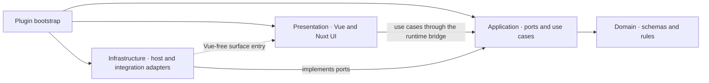
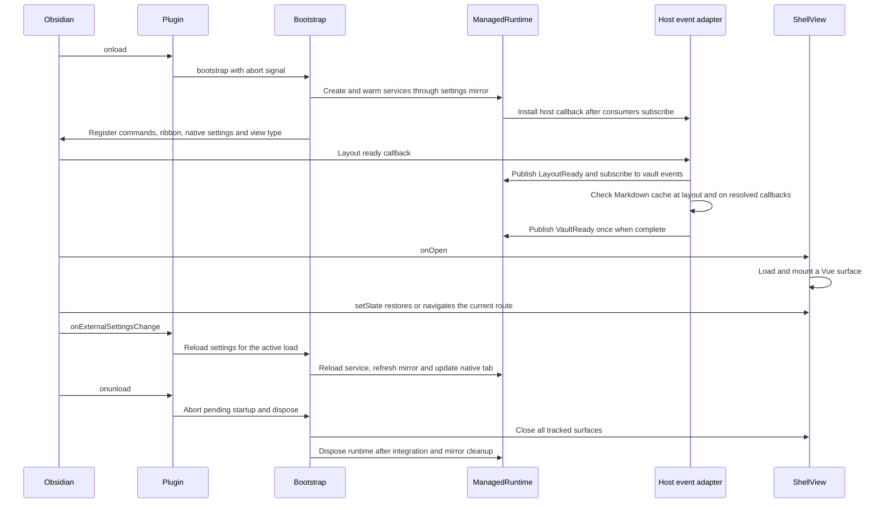

# Architecture

Product Engineering is a desktop Obsidian plugin. The application defines its services independently of the host. The Obsidian plugin, browser harness and tests supply adapters to the same graph. [Architecture decision](../adr/0002-architecture.md)

## Layers and ports

- **Domain** owns pure rules, including schemas for technical settings and records, filename rules, field checks and issue codes. Application catalogs turn those codes into user messages. [Domain entries](../../src/domain)
- **Application** defines Effect ports and services. `AppAdapters` supplies the settings store, notifications, clipboard, host information, logging, incidents, host events, note store, note opener, ID generator and optional agent chat. The application composes them with its event bus, settings and notes services. [Application graph](../../src/application/app-services-layer.ts), [Shell ports](../../src/application/shell/ports.ts), [Note ports](../../src/application/notes/ports.ts)
- **Infrastructure** connects those ports to the host. Obsidian imports live in the plugin and bootstrap entry points and the Obsidian adapters. The memory adapter supplies note behavior to the harness and tests. Node platform adapters implement the MCP listener and provider CLI process boundary. [Obsidian assembly](../../src/infrastructure/obsidian/app-layer.ts), [Memory notes](../../src/infrastructure/memory/notes), [MCP adapter](../../src/infrastructure/mcp), [Provider CLI adapter](../../src/infrastructure/provider-cli)
- **Presentation** owns rendering and view state. Its Vue runtime bridge exposes `useQuery`, `useCommand` and `useStream`. Keep Effect imports there. The host imports the Vue-free shell entry and opens the actual mount through its loader. [Runtime bridge](../../src/presentation/shell/runtime), [Host entry](../../src/presentation/shell/host.ts)

## Modules and enforcement

The core modules are `shell` and `notes`. The feature modules are `items` and `integrations`. Each module has an application manifest and a presentation screen manifest. The shared `APP_MODULES` and `MODULE_SCREENS` registries compose catalogs, errors, command providers, services, note types, routes and sections. Dependencies point from features toward `notes` and `shell`. A feature-to-feature import uses a public entry and keeps the graph acyclic. [Application modules](../../src/application/modules.ts), [Manifest contract](../../src/application/module.ts), [Presentation registry](../../src/presentation/app-surface.ts)

Use a module's public index entry from outside its folder. The shell has a Vue-free host entry. The notes adapter entry supplies storage mechanics to infrastructure. Presentation screen entries describe lazy routes and are consumed by presentation composition. [Shell host entry](../../src/presentation/shell/host.ts), [Note adapter entry](../../src/application/notes/adapter.ts), [Items screen manifest](../../src/presentation/items/screens.ts)

| Rule | Enforcement and evidence |
| --- | --- |
| Host, Effect and memory import boundaries | Oxlint bans forbidden imports at the source. The Vitest Obsidian guard requires the host double in tests that import Obsidian. [Oxlint](../../.oxlintrc.json), [Test guard](../../configs/vitest.config.ts) |
| Public entries and dependency direction | ESLint derives module rules from `APP_MODULES`. Fallow checks the generated zone graph. Both rejected a planted `notes` to `items` application import during tracer acceptance. [ESLint](../../eslint.config.mjs), [Module list reader](../../scripts/modules.mjs), [Fallow rules](../../configs/fallow.config.mjs) |
| Module registration and generated config | The module test detects unregistered feature folders. TypeScript checks screen manifest completeness. `npm run analyze` checks the generated Fallow config before analyzing the graph. [Module tests](../../tests/unit/application/modules.test.ts), [Screen manifest types](../../src/presentation/shell/routing.ts), [Fallow config check](../../scripts/fallow-config.mjs) |
| Lazy view loading and isolated distribution | The lazy presentation test checks plugin startup before Vue, Nuxt UI and TanStack Form evaluate. The distribution tests reject unscoped selectors, unexpected externals and the memory adapter's test marker. [Lazy presentation test](../../tests/dom/lazy-presentation.test.ts), [Distribution tests](../../tests/unit/scripts/check-dist.test.ts) |

## Runtime and lifecycle

The diagram shows a cold layout. An already-ready workspace can run the layout callback during runtime warm-up. Obsidian can supply view state while the surface loader is pending, so route state belongs to the leaf from construction. A closing leaf releases any late mount. Bootstrap runs its cleanup steps in reverse order and keeps the runtime available until the surfaces, MCP listener and settings mirror have closed. [Plugin entry](../../src/main.ts), [Bootstrap](../../src/bootstrap.ts), [Shell view](../../src/infrastructure/obsidian/shell/shell-view.ts)

## Events, language and settings

After `LayoutReady`, the Obsidian adapter maps file creation, modification, rename and deletion and metadata changes into one scoped application event bus. It checks the Markdown cache at layout and on subsequent `resolved` callbacks. `VaultReady` marks the initial cache-complete snapshot. Subscribe before the host producer starts, discard file work before the snapshot, and re-read later changes by path so repeats are safe. [Event decision and measurements](../adr/0004-event-system.md), [Host events](../../src/infrastructure/obsidian/shell/events.ts), [Cache completeness](../../src/infrastructure/obsidian/shell/cache-completeness.ts)

The app reads Obsidian's language during load, accepts English and German, and defaults to English for unsupported languages. Every module supplies a typed catalog in both languages. The fixed ribbon title uses the product name, and translation stays at the application and presentation boundary. [Language adapter](../../src/infrastructure/obsidian/shell/language.ts), [Catalog composition](../../src/application/messages.ts)

The plugin's data.json holds versioned technical settings. The schema covers log level, the record root folder, MCP port and sharing, and the two optional CLI paths. The native settings tab exposes the log and integration controls. The settings service serializes saves and publishes committed values. External changes use the same settings decoder, and a root-folder change rebuilds the index. Unreadable settings files and newer settings versions enter a read-only state. [Settings schema](../../src/domain/shell/settings.ts), [Settings service](../../src/application/shell/settings-service.ts), [Native tab](../../src/infrastructure/obsidian/shell/settings-tab.ts)

## Vault records and the tracer

Markdown frontmatter supplies the schema marker, ID and named fields. The record type and version come from `schema`. The stable `id` carries identity across renames. The root and type folders choose where creation writes. The index recognizes records across the vault and exposes typed snapshots, including field issues and read-only records, plus a separate list of unindexed notes with data issues. [Note codec](../../src/domain/notes/codec.ts), [Note type registry](../../src/application/note-types.ts), [Note index](../../src/application/notes/index-live.ts)

`NoteStore` is the vault access port. The Obsidian adapter uses the host cache for reads and `Vault.process` for atomic edits. Writes merge fields against the current text, check the re-parsed YAML, and retain unedited text and body bytes. The index fills on `VaultReady` and batches later updates. The generic `notes` record kit provides listing, create, update and removal with filename following and conflict handling. [Obsidian note store](../../src/infrastructure/obsidian/notes/note-store.ts), [Text write checks](../../src/application/notes/note-text.ts), [Record kit](../../src/application/notes/record-kit.ts)

**Items** is the worked feature. Its type owns title, status and due date. Its application commands validate and delegate to the record kit. Its settings section renders indexed rows and shared record form behavior. The Data issues section shows unindexed notes with a link to open them in Obsidian. [Item type](../../src/domain/items/item-type.ts), [Item use cases](../../src/application/items/use-cases.ts), [Items view](../../src/presentation/items/components/ItemSettings.vue), [Data issues](../../src/presentation/notes/components/DataIssues.vue)

## Local integrations

Native settings let the user start and stop a Streamable HTTP MCP endpoint on loopback and copy its active bearer credential. A new listener uses a fresh in-memory token. `list_items` and `get_item` grant read access to explicitly selected items. The selected IDs are persisted, new grants take effect on start, and a committed deselection revokes access during the session. The tool adapter reads the current item index and returns ID, title, status and optional due date. [Listener](../../src/infrastructure/mcp/local-server.ts), [Tool definitions](../../src/application/integrations/mcp/shared-item-tools.ts), [Item access](../../src/infrastructure/obsidian/integrations/mcp-items.ts), [Native sharing test](../../tests/e2e/specs/mcp-sharing.e2e.ts)

The Agent chat view keeps a separate transcript for each mounted chat session. It sends text turns through `AgentChat` and TanStack AI to the installed Claude Code or Codex CLI. Requests use the configured executable path or discovery. The CLI manages its own login and account. Each turn runs with restricted flags in a temporary working directory. Process output streams to the view, and closing or cancelling the session aborts the active turn. [AgentChat service](../../src/application/integrations/chat/service.ts), [Provider adapter](../../src/infrastructure/provider-cli/index.ts), [Provider protocol](../../src/infrastructure/provider-cli/protocol.ts), [Chat session](../../src/presentation/integrations/chat-session.ts)

## Presentation and CSS

One Vue app mounts lazily per view. The frame renders routes and owns the leaf's back and forward controls. Obsidian saves the current route in the workspace layout. Settings sections and optional badges load independently. The shell provides a portal inside each scoped root and marks the frame inert while a modal is open. The record flow restores focus after the updated row appears or the removed row disappears. [Navigation decision](../adr/0008-navigation-and-view-state.md), [Frame](../../src/presentation/shell/components/AppFrame.vue), [Modals](../../src/presentation/shell/modal.ts), [Record focus](../../src/presentation/notes/focus-after.ts)

The stylesheet imports Tailwind theme and utilities, selected Nuxt UI component sources, the tokens and the bridge. The scope transform confines selectors to `.product-engineering-root` and flattens layers in the emitted CSS. The scoped base reset supplies consistent heading, list and button styling while keeping utilities above its specificity. Derived tokens map Obsidian colors to the foreground, fill and border roles Nuxt UI uses. Keyframes and utility classes carry the plugin prefix. The harness provides fake host rules so the same rendered surfaces exercise those boundaries. [Stylesheet sources](../../src/styles/app.css), [Tokens](../../src/styles/tokens.css), [Bridge and reset](../../src/styles/bridge.css), [Scoping](../../scripts/scope-css.mjs), [Fake host](../../harness/fake-host.css)

The owner document determines light and dark classes and portal placement. Build-time shims keep theme and icon setup from modifying `document.head`. Keep the component source list and offline icons current when adding UI. [Host theme binding](../../src/presentation/shell/theme.ts), [Build shims](../../scripts/no-head-plugins.mjs), [Offline icon list](../../configs/vite.shared.ts)

## Repository layout

| Directory | Contents |
| --- | --- |
| [`src`](../../src) | Plugin entry, composition, four layers and styles. |
| [`harness`](../../harness) | Browser entry, fixture scenarios and fake host styles. |
| [`tests`](../../tests) | Unit, DOM and native Obsidian suites, doubles and fixtures. |
| [`configs`](../../configs) | Build, testing, scanner and architecture configuration. |
| [`scripts`](../../scripts) | Verification, development install and release utilities. |
| [`docs`](..) | Decisions, engineering guides, contracts, concept and plans. |
| [`.github`](../../.github) and [`.githooks`](../../.githooks) | GitHub workflow discovery and versioned local hook sources. |

| Root files | Why they stay at the root |
| --- | --- |
| [`manifest.json`](../../manifest.json), [`versions.json`](../../versions.json) | Obsidian reads plugin identity and selects versions by app compatibility. |
| [`package.json`](../../package.json), [`package-lock.json`](../../package-lock.json), [`.npmrc`](../../.npmrc), [`.nvmrc`](../../.nvmrc) | npm reads scripts, exact dependency resolution and install conventions here. The local shell and CI use the same Node major. |
| [`tsconfig.json`](../../tsconfig.json), [`eslint.config.mjs`](../../eslint.config.mjs), [`.oxlintrc.json`](../../.oxlintrc.json), [`.prettierrc.json`](../../.prettierrc.json), [`.prettierignore`](../../.prettierignore) | Project discovery gives editors and CLI tools shared roots and formatting rules. |
| [`.editorconfig`](../../.editorconfig), [`.gitattributes`](../../.gitattributes), [`.gitignore`](../../.gitignore), [`.env.local.example`](../../.env.local.example) | Editor conventions, Git file handling and the local installation template apply repo-wide. |
| [`README.md`](../../README.md), [`AGENTS.md`](../../AGENTS.md), [`CLAUDE.md`](../../CLAUDE.md), [`GLOSSARY.md`](../../GLOSSARY.md) | The project entry, contributor instructions and domain vocabulary are easy to discover from a fresh checkout. |
| [`LICENSE`](../../LICENSE), [`THIRD-PARTY-NOTICES.txt`](../../THIRD-PARTY-NOTICES.txt) | The source license and bundle notices accompany the project and release. |
